<div align="center">

# 🛡️ PENETRATION TESTING REPORT

### Footprinting & Network Scanning Phases
**W2-PM-FINAL | CYBERSECURITY | NETWORKWALKS**

<br>

[](#)
[](#)
[](#)
[](#)
[](#)
[](#)
[](#)
[](#)
[](#)

</div>

---

| **Field** | **Detail** |
| :--- | :--- |
| **Pentester / Analyst Name** | Dibakor Pramanik |
| **GitHub Profile** | [@Dibakor007](https://github.com/Dibakor007) |
| **Program & Batch** | B084 – Networkwalks Cybersecurity Analyst |
| **Modules Completed** | **W2-PM1** (Multiple Kali Tools) & **W2-PM5** (Zenmap Network Scanning) |
| **Assessment Target** | `networkwalks.com` (`192.232.216.135`) |
| **Assessment Status** | Completed |

---

## Table of Contents
1. [Executive Summary](#1-executive-summary)
2. [Scope of Work & Rules of Engagement](#2-scope-of-work--rules-of-engagement)
3. [Letter of Authorization (LOA)](#3-letter-of-authorization-loa)
4. [Methodology](#4-methodology)
5. [Module 1: W2-PM1 – Footprinting & Reconnaissance Attacks](#5-module-1-w2-pm1--footprinting--reconnaissance-attacks)
   - [5.1 WHOIS Domain Intelligence](#51-tool-1--whois)
   - [5.2 WhatWeb Web Fingerprinting](#52-tool-2--whatweb)
   - [5.3 NSLookup DNS Interrogation](#53-tool-3--nslookup)
   - [5.4 cURL HTTP Header Banner Grabbing](#54-tool-4--curl)
   - [5.5 Wafw00f Web Application Firewall Detection](#55-tool-5--wafw00f)
   - [5.6 DNSRecon Comprehensive DNS Enumeration](#56-tool-6--dnsrecon)
6. [Module 2: W2-PM5 – Zenmap / Nmap Network Scanning](#6-module-2-w2-pm5--zenmap--nmap-network-scanning)
   - [6.1 Zenmap Intense Scan Execution](#61-zenmap-intense-scan)
   - [6.2 Open Ports & Running Services Discovery](#62-open-ports--running-services)
   - [6.3 Network Topology Mapping](#63-network-topology-mapping)
   - [6.4 Host Details & OS Fingerprinting](#64-host-details--operating-system-fingerprinting)
   - [6.5 CLI Service Version Detection (`nmap -sV`)](#65-command-line-service-detection-nmap--sv)
7. [Comprehensive Findings & Threat Analysis](#7-comprehensive-findings--threat-analysis)
8. [Remediation & Security Hardening Recommendations](#8-remediation--security-hardening-recommendations)
9. [Conclusion & Sign-off](#9-conclusion--sign-off)

---

## 1. Executive Summary

During Week 2 of the **Networkwalks Cybersecurity Internship (Batch B084)**, an authorized, non-intrusive security evaluation was conducted against the target asset `networkwalks.com` (IP: `192.232.216.135`). 

The assessment focused exclusively on **Phase 1 (Footprinting & Passive/Active Reconnaissance)** and **Phase 2 (Network Scanning & Service Enumeration)**:
- **W2-PM1:** Passive and active OSINT reconnaissance using 6 core Kali Linux utilities (`whois`, `whatweb`, `nslookup`, `curl`, `wafw00f`, and `dnsrecon`).
- **W2-PM5:** Comprehensive network host discovery, port enumeration, service identification, and OS fingerprinting using **Zenmap** (GUI) and **Nmap** (CLI).

The objective was to identify public exposure points, running services, web stack architecture, DNS configurations, and potential attack vectors before an adversary could exploit them, while strictly adhering to the authorized boundaries.

---

## 2. Scope of Work & Rules of Engagement

The assessment was executed under strict adherence to ethical hacking principles and authorization bounds:

- **In-Scope Target:** `networkwalks.com` (and its associated DNS records) / Resolved IP: `192.232.216.135`
- **Authorized Testing Activities:**
  - Passive and active open-source intelligence (OSINT) gathering.
  - DNS interrogation and record harvesting.
  - Web technology fingerprinting and HTTP header banner analysis.
  - Port scanning, service version discovery, and OS fingerprinting via Zenmap and Nmap.
- **Strictly Prohibited Activities:**
  - Exploitation, vulnerability exploitation payloads, or privilege escalation.
  - Denial of Service (DoS) / Distributed Denial of Service (DDoS) attempts.
  - Brute-force attacks against SSH, FTP, or administrative portals.
  - Accessing, altering, downloading, or exfiltrating client or user data.
  - Social engineering or phishing targeting Networkwalks personnel.

---

## 3. Letter of Authorization (LOA)

```text
========================================================================================
                          NETWORKWALKS ACADEMY
           LETTER OF AUTHORIZATION FOR CYBERSECURITY TESTING
========================================================================================
Reference No.       : NW-LOA-B084-017
Date of Issue       : 10 November 2026
Client / Target     : Networkwalks (networkwalks.com)
Authorized Tester   : Dibakor Pramanik (Cybersecurity Analyst / Intern)
Program / Batch     : B084 - Networkwalks Cybersecurity Analyst
Authorization Valid : 10 November 2026 to 17 November 2026
----------------------------------------------------------------------------------------
1. Scope of Authorization:
   - Target: networkwalks.com and associated authoritative DNS records.
   - Target IP: 192.232.216.135
   - Tester's private Kali Linux lab environment.
   - Any external host, cloud subsystem, or third-party domain is strictly OUT OF SCOPE.

2. Authorized Activities (Phases 1 & 2):
   - Passive and light footprinting / reconnaissance tools (whois, whatweb, nslookup, 
     curl, wafw00f, dnsrecon).
   - Network scanning and port discovery using Zenmap / Nmap.

3. Prohibited Activities:
   - No exploitation, vulnerability attacking, or data alteration.
   - No DoS, DDoS, brute-force, or fuzzing capable of disrupting services.
   - No social engineering or phishing.

4. Client & Tester Acknowledgment:
   Authorized by (Client/Target) : Sonia John, Managing Director, Networkwalks
   Acknowledged by (Tester)     : Dibakor Pramanik, Cybersecurity Analyst, Batch B084
========================================================================================
```

---

## 4. Methodology

The testing workflow followed standard cybersecurity testing methodologies including **PTES (Penetration Testing Execution Standard)** and **NIST SP 800-115**:

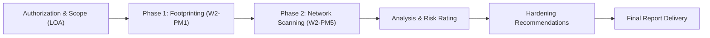

---

## 5. Module 1: W2-PM1 – Footprinting & Reconnaissance Attacks

In this module, 6 Kali Linux tools were leveraged to profile the target infrastructure.

### 5.1 Tool 1 – `whois`
- **Command:** `whois networkwalks.com`
- **Objective:** Harvest domain registrar details, administrative registry information, creation/expiration dates, and name server allocations.
- **Key Findings:**
  - **Domain Name:** `NETWORKWALKS.COM`
  - **Registrar:** `GoDaddy.com, LLC` (IANA ID: `146`)
  - **Creation Date:** `2019-11-06T22:51:46Z`
  - **Registry Expiry:** `2027-11-06T22:51:46Z`
  - **Name Servers:** `NS6135.HOSTGATOR.COM`, `NS6136.HOSTGATOR.COM`
  - **Status Flags:** `clientDeleteProhibited`, `clientRenewProhibited`, `clientTransferProhibited`, `clientUpdateProhibited`

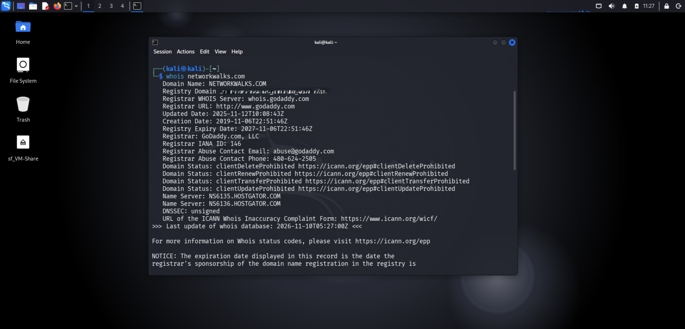

---

### 5.2 Tool 2 – `whatweb`
- **Command:** `whatweb networkwalks.com`
- **Objective:** Fingerprint web server software, content management system (CMS), scripting libraries, and backend frameworks.
- **Key Findings:**
  - **HTTP Status:** `301 Moved Permanently` ➔ `200 OK` (HTTPS redirect)
  - **IP Address:** `192.232.216.135` (Hosted in the United States)
  - **CMS & Platform:** `WordPress 7.1.4`, `WordPress Download Manager 3.3.76`
  - **Frontend Libraries:** `Bootstrap 7.1.4`, `JQuery`, `HTML5`
  - **Web Server:** `Apache`
  - **Page Title:** `Networkwalks Academy`
  - **Cookies:** `__wpdm_client` (HttpOnly, Secure)

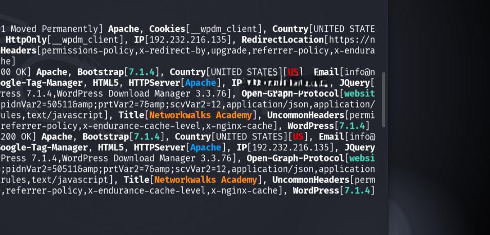

---

### 5.3 Tool 3 – `nslookup`
- **Command:** `nslookup networkwalks.com`
- **Objective:** Verify DNS resolution, default DNS server configuration, and IP address mappings.
- **Key Findings:**
  - **Local Resolver:** `192.168.0.1#53`
  - **Non-authoritative Answer:** `networkwalks.com` resolves directly to IPv4 `192.232.216.135`

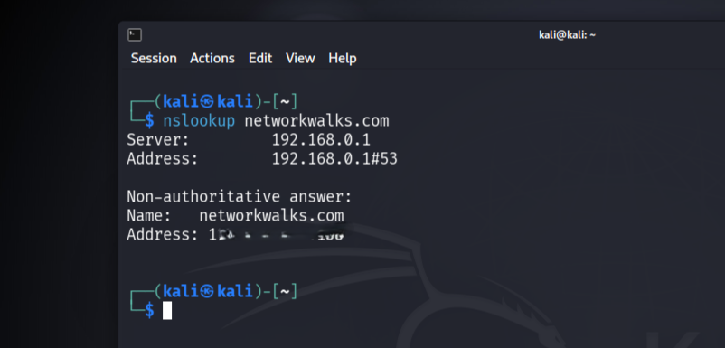

---

### 5.4 Tool 4 – `curl`
- **Command:** `curl -I https://networkwalks.com`
- **Objective:** Inspect HTTP response headers, evaluate protocol versions, caching directives, and security header configurations.
- **Key Findings:**
  - **Protocol:** `HTTP/2 200`
  - **Server Banner:** `Apache`
  - **Caching / Reverse Proxy:** `x-nginx-cache: WordPress`, `x-endurance-cache-level: 0`
  - **Content Type:** `text/html; charset=UTF-8`
  - **Security Observation:** Critical security headers such as `Strict-Transport-Security` (HSTS), `X-Frame-Options`, and `Content-Security-Policy` (CSP) were absent or not enforced at the top response level.

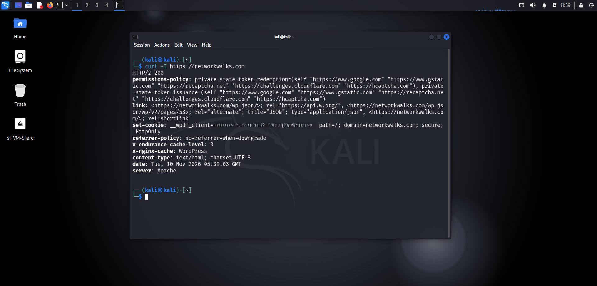

---

### 5.5 Tool 5 – `wafw00f`
- **Command:** `wafw00f https://networkwalks.com`
- **Objective:** Detect and identify Web Application Firewalls (WAF) or perimeter filters protecting the web application.
- **Key Findings:**
  - **WAF Detected:** `ModSecurity (SpiderLabs)`
  - **Requests Sent:** 2 diagnostic probes
  - **Implication:** The application benefits from ModSecurity rule filtering against generic web exploits (e.g., SQL injection, XSS).

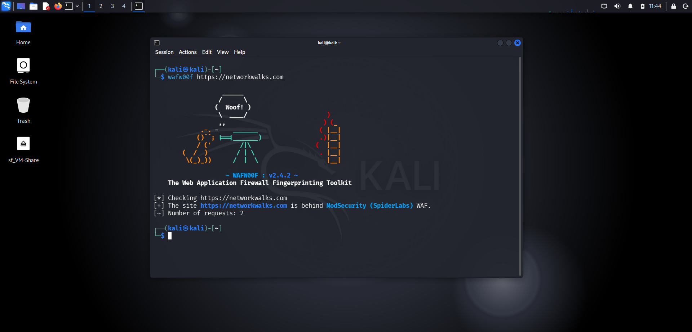

---

### 5.6 Tool 6 – `dnsrecon`
- **Command:** `dnsrecon -d networkwalks.com`
- **Objective:** Perform advanced DNS record enumeration, discover zone configurations, mail exchanges, and service records.
- **Key Findings:**
  - **SOA Record:** `ns6135.hostgator.com` (`50.87.144.87`)
  - **NS Records:** `ns6135.hostgator.com`, `ns6136.hostgator.com` (`192.232.216.131`)
  - **BIND Version:** `9.16.23-RH` exposed
  - **MX Record:** `mail.networkwalks.com` (`192.232.216.135`)
  - **A Record:** `networkwalks.com` ➔ `192.232.216.135`
  - **TXT Records:**
    - Google Site Verification: `google-site-verification=rr04eRmqHoWY3XemnizDNVK4q75X-Ij-mjgEeg-UsYI`
    - SPF Record: `v=spf1 +a +mx +ip4:50.87.144.87 +include:websitewelcome.com ~all`
  - **SRV Records:** 8 cPanel Auto-discovery SRV records identified (`_autodiscover._tcp.networkwalks.com` pointing to `cpanelemaildiscovery.cpanel.net:443`).

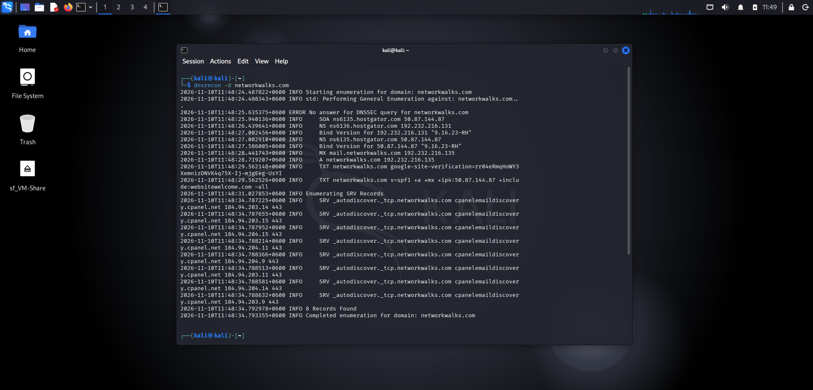

---

## 6. Module 2: W2-PM5 – Zenmap / Nmap Network Scanning

### 6.1 Zenmap Intense Scan
- **Command Executed:** `nmap -T4 -A -v networkwalks.com`
- **Target:** `networkwalks.com (192.232.216.135)`
- **Profile:** Intense Scan (Service detection `-sV`, OS detection `-O`, Traceroute, and default NSE scripts)

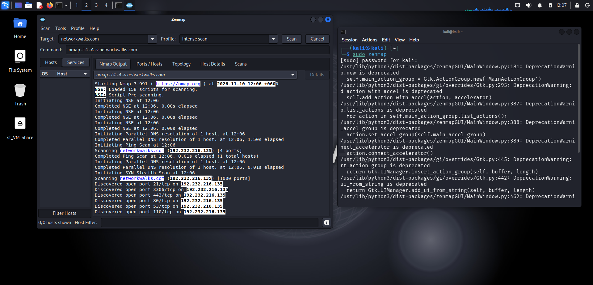

---

### 6.2 Open Ports & Running Services
Zenmap identified **15 open ports**, **6 filtered ports**, and **979 closed ports** across 1,000 scanned TCP ports:

| **Port** | **Protocol** | **State** | **Service** | **Version / Banner** |
| :---: | :---: | :---: | :---: | :--- |
| **21** | tcp | open | ftp | Pure-FTPd (with SSL/TLS) |
| **22** | tcp | open | ssh | OpenSSH 9.9 (protocol 2.0) |
| **25** | tcp | open | smtp | Exim smtpd 4.100.1 |
| **26** | tcp | open | smtp | Exim smtpd 4.100.1 |
| **53** | tcp | open | domain | ISC BIND 9.16.23 (RedHat Linux) |
| **80** | tcp | open | http | Apache httpd |
| **110** | tcp | open | pop3 | Dovecot pop3d |
| **143** | tcp | open | imap | Dovecot imapd |
| **443** | tcp | open | ssl/http | Apache httpd |
| **465** | tcp | open | ssl/smtp | Exim smtpd 4.100.1 |
| **587** | tcp | open | smtp | Exim smtpd 4.100.1 |
| **993** | tcp | open | ssl/imap | Dovecot imapd |
| **995** | tcp | open | ssl/pop3 | Dovecot pop3d |
| **2222** | tcp | open | ssh | OpenSSH 9.9 (protocol 2.0) |
| **3306** | tcp | open | mysql | MySQL 5.7.44-48 |
| **1719** | tcp | filtered | h323gatestat | — |
| **1720** | tcp | filtered | h323q931 | — |
| **2001** | tcp | filtered | dc | — |
| **5060** | tcp | filtered | sip | — |
| **5061** | tcp | filtered | sip-tls | — |
| **49152**| tcp | filtered | unknown | — |

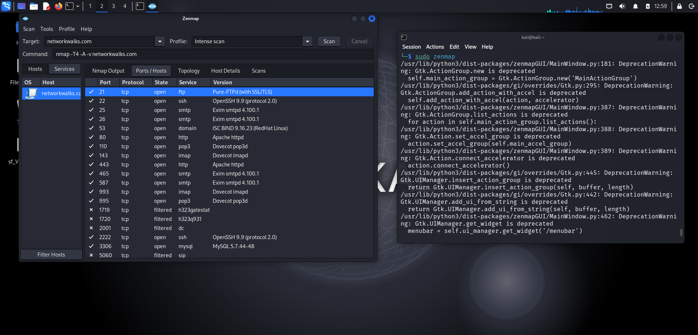

---

### 6.3 Network Topology Mapping
The Zenmap Topology tab visually represents the routing path from the local attacking machine (`localhost`) through network hops to the target host `networkwalks.com (192.232.216.135)`.

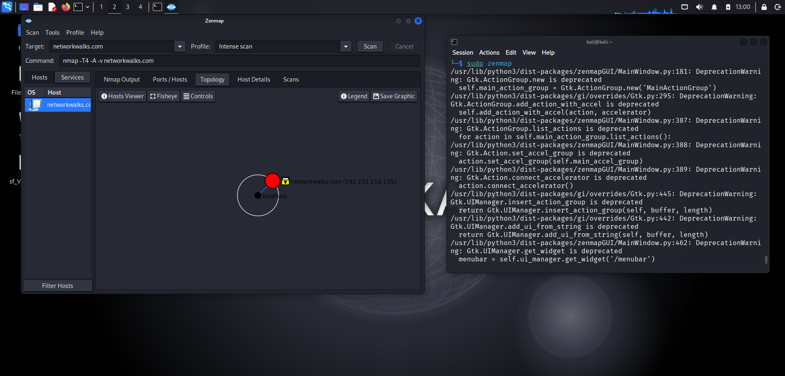

---

### 6.4 Host Details & Operating System Fingerprinting
- **Host Status:** Up (Latency ~0.25s)
- **Hostnames:** `networkwalks.com` (user-specified), `192-232-216-135.unifiedlayer.com` (PTR record)
- **Underlying OS Fingerprint:** Linux Kernel / RedHat Linux enterprise ecosystem
- **Host System Signature:** `gator3068.hostgator.com` running Apache, cPanel/WHM architecture.

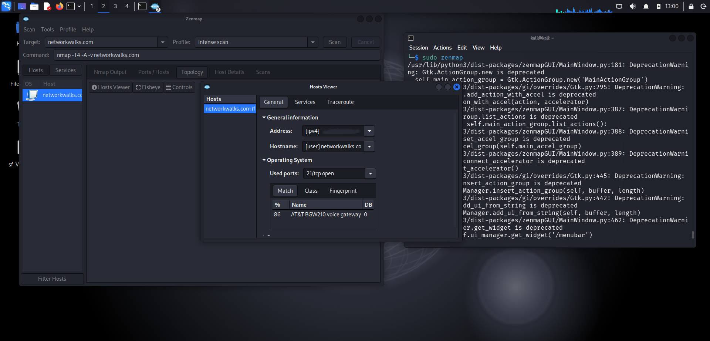

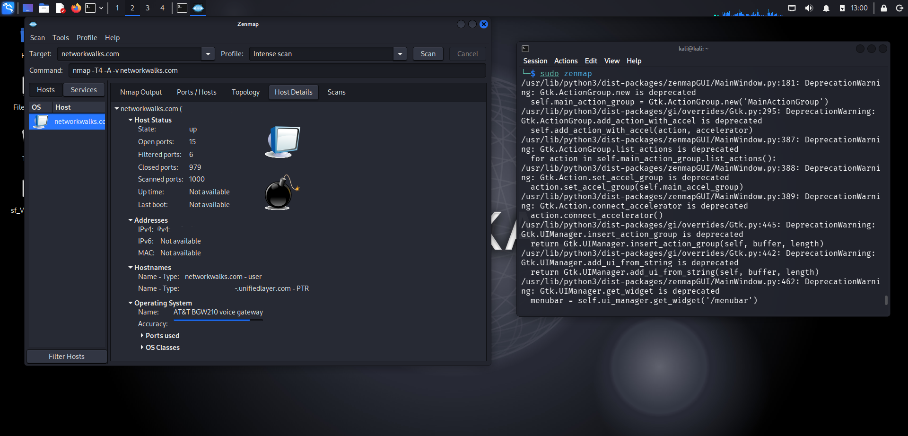

---

### 6.5 Command-Line Service Detection (`nmap -sV`)
To validate the graphical output from Zenmap, an active service version scan was executed directly in the Kali terminal:

```bash
nmap -sV networkwalks.com -T4
```

The CLI scan independently corroborated all service names, daemon versions, and underlying HostGator/UnifiedLayer hosting architecture.

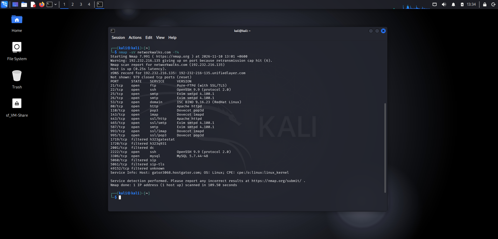

---

## 7. Comprehensive Findings & Threat Analysis

| **ID** | **Target / Port** | **Vulnerability / Finding** | **Severity** | **Threat Analysis & Attack Vector** |
| :---: | :---: | :--- | :---: | :--- |
| **SEC-01** | Port 3306/tcp | Direct Public Exposure of MySQL Database | **HIGH** | MySQL is exposed directly to the public Internet (`0.0.0.0/0`). External threat actors can attempt brute-force authentication, exploit MySQL CVEs, or compromise backend databases. |
| **SEC-02** | Port 21/tcp | Exposed FTP Service (Pure-FTPd) | **MEDIUM** | Plain FTP exposes authentication credentials in cleartext if unencrypted logins are permitted. Recommended to restrict access or enforce strict TLS. |
| **SEC-03** | Ports 22, 2222/tcp | Dual SSH Listening Daemons | **LOW** | Dual OpenSSH instances increase service surface area. Both instances should be audited for root login disabling and key-only authentication. |
| **SEC-04** | Port 53, 80, 443 | Precise Version Disclosure in Banners | **LOW** | Exact versions of Apache, BIND (`9.16.23-RH`), Exim (`4.100.1`), and Dovecot are openly broadcasted, simplifying reconnaissance for known CVE exploits. |
| **SEC-05** | Ports 25, 110, 143 | Unencrypted Mail Protocols Enabled | **LOW** | Cleartext POP3 (110) and IMAP (143) ports remain accessible alongside secure counterparts (993, 995). Cleartext channels risk credential interception. |

---

## 8. Remediation & Security Hardening Recommendations

### 8.1 Immediate Remediation (High Priority)
1. **Firewall Rule for Port 3306 (MySQL):**
   - Bind MySQL exclusively to `127.0.0.1` (`bind-address = 127.0.0.1` in `my.cnf`).
   - Implement perimeter firewall rules (iptables/UFW/cPanel Host Access Control) to drop incoming external packets on port 3306.
2. **Deprecate Unencrypted Protocol Endpoints:**
   - Close plain POP3 (Port 110) and plain IMAP (Port 143); enforce SSL/TLS exclusively on ports 993 and 995.

### 8.2 Architectural Hardening (Medium Priority)
1. **Banner Masking & Information Obfuscation:**
   - Configure Apache: `ServerTokens Prod` and `ServerSignature Off`.
   - Obfuscate BIND version response: configure `version "none";` in `named.conf`.
2. **Implement Enforced HTTP Security Headers:**
   - Add `Strict-Transport-Security: max-age=31536000; includeSubDomains`.
   - Add `X-Frame-Options: SAMEORIGIN` and `X-Content-Type-Options: nosniff`.
   - Deploy a Content Security Policy (CSP).

### 8.3 Long-Term Monitoring
1. **Intrusion Prevention & Rate Limiting:** Ensure fail2ban or CSF (ConfigServer Security & Firewall) is active to block automated brute-force attacks against SSH and Mail endpoints.
2. **Continuous Vulnerability Auditing:** Perform scheduled automated internal and external vulnerability assessments.

---

## 9. Conclusion & Sign-off

The Phase 1 (Reconnaissance) and Phase 2 (Network Scanning) assessment of `networkwalks.com` was successfully completed within the authorized bounds of **NW-LOA-B084-017**. All technical evidence, command outputs, and analytical assessments have been documented and corroborated across multiple independent tools.

**Assessor Sign-off:**
- **Intern / Pentester:** Dibakor Pramanik
- **Batch:** B084 – Networkwalks Cybersecurity Analyst
